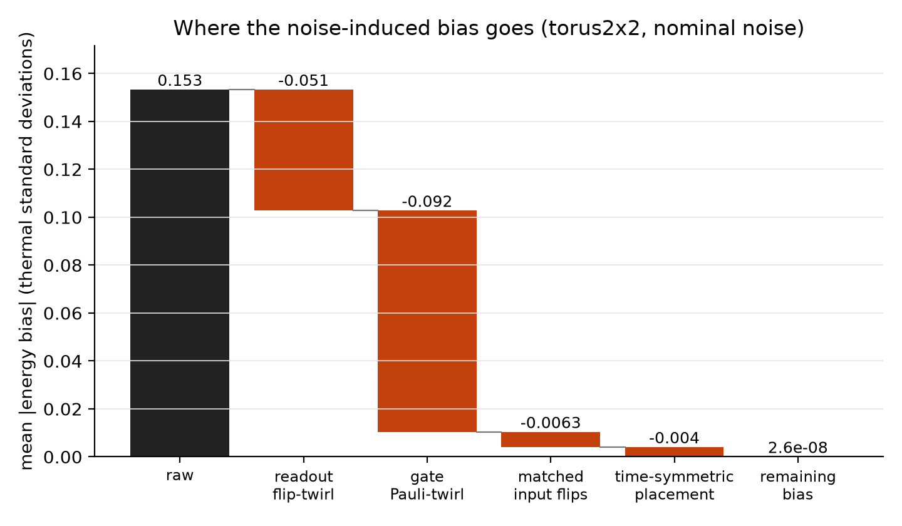
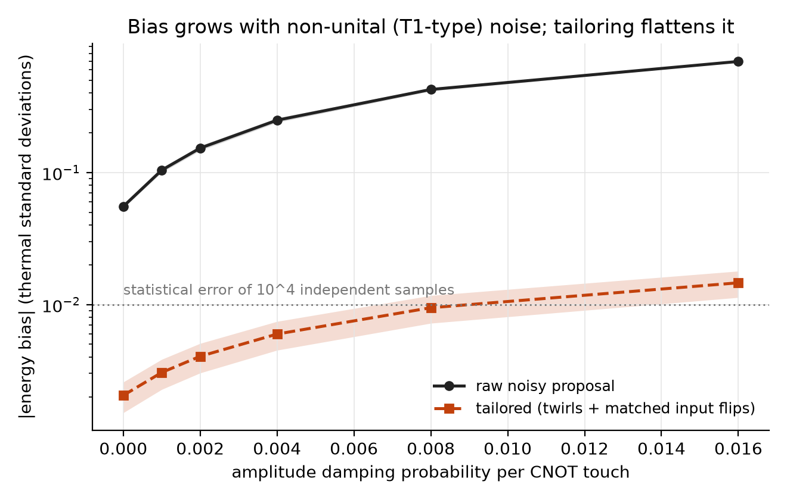
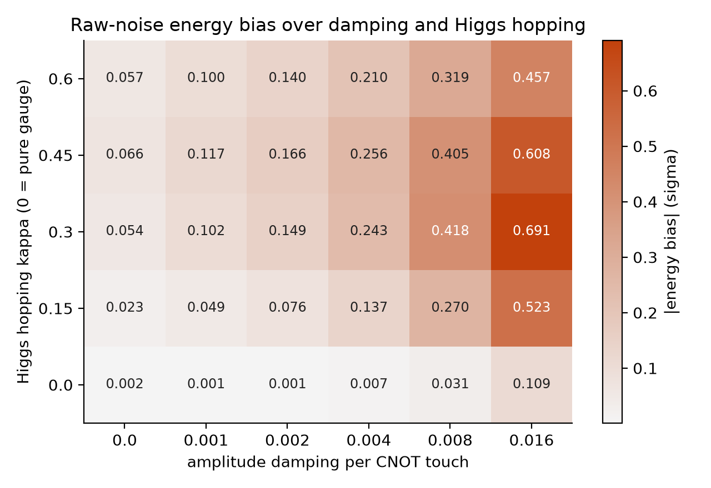
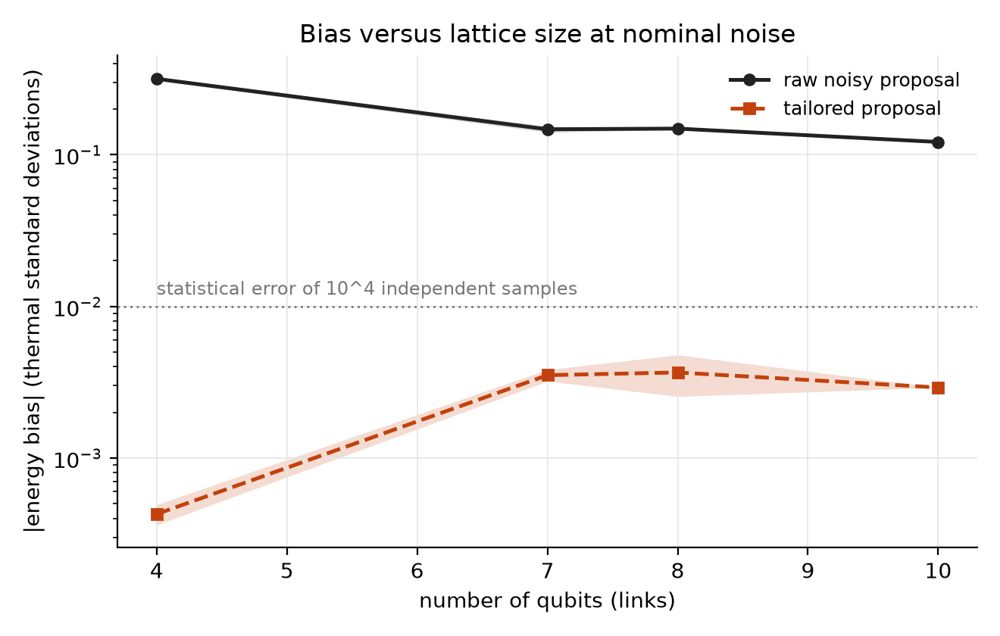

# Does a noisy quantum proposal still sample the right gauge theory?

[](LICENSE)
[](https://www.python.org/)
[](https://github.com/pradeepdegalaroyal/noisy-quantum-proposal-mcmc-gauge-bias/actions/workflows/ci.yml)

**Abstract.** A Markov chain Monte Carlo (MCMC) sampler whose proposal comes from a short quantum time-evolution circuit has the correct Boltzmann target only if the proposal is symmetric, and hardware noise destroys that symmetry. Using exact density-matrix transition matrices for a Z2 gauge-Higgs model with 4 to 10 qubits, I show that at a nominal noise level the stationary energy is off by 0.153 ± 0.006 thermal standard deviations, far above the 0.01 statistical error of 10^4 independent samples. A compiler-level recipe (Pauli-twirled gates, flip-twirled readout, matched input flips) cuts this to 0.00405 ± 0.00102 (a 37.9-fold reduction) at 90% of the noiseless mixing rate; everything is classical simulation and no quantum advantage is claimed.

## The problem

Lattice gauge theories are central to high-energy physics (HEP), and sampling their Boltzmann distribution is a natural job for a quantum processor: prepare the current configuration, evolve it under a short circuit built from the target energy plus a transverse field, measure, and accept or reject with the ordinary Metropolis rule. This rule assumes the proposal probability `Q(s -> s')` equals `Q(s' -> s)`. The noiseless circuit satisfies this exactly (its unitary is complex-symmetric). A noisy one generally does not, and then the chain converges to a **wrong distribution, and more samples never fix it**.

## Why existing work does not answer this

The supplied literature judges hardware by gate fidelity, logical coherence or learnability, not by what noise does to the stationary law of a sampler. The roadmap of Bauer et al. (2023, digital object identifier (DOI) 10.1103/PRXQuantum.4.027001) asks for algorithm and hardware co-design for HEP. Ma et al. (2023, DOI 10.1038/s41586-023-06438-1) show that most gate errors in an ytterbium qubit are decays out of the qubit space, and Evered et al. (2023, DOI 10.1038/s41586-023-06481-y) reach 99.5% two-qubit fidelity, yet neither tells an algorithm designer whether the residual structured noise biases the output of a sampler. Jerbi et al. (2023, DOI 10.1038/s41467-023-36159-y) compare circuit-based learning models under near-term resource limits, again without sampling bias. The reading list has no quantum-MCMC paper; the proposal construction here is the generic time-evolved-proposal idea and is not cited. The full related-work table (13 papers, four roles) is in [`docs/RESEARCH_GAP.md`](docs/RESEARCH_GAP.md).

## What is new here

* The bias is computed **exactly**, from the full noisy transition matrix with the stationary distribution found by eigen-decomposition, so no sampling noise is mixed into the bias estimate.
* A short argument and a numerical check show which noise preserves detailed balance: Pauli (unital) noise placed symmetrically in time, and a symmetric classical readout matrix applied on both sides of the circuit. Amplitude damping (energy-relaxation, T1-type decay) and asymmetric readout do not.
* The bias is split into pieces with an ablation (waterfall), swept over amplitude damping and Higgs hopping, and tracked with lattice size.
* A negative finding is reported alongside: for a pure gauge target at nominal noise the energy is almost blind to the bias although the link-configuration distribution is not.

## The fix, in one picture

```mermaid
%%{init: {'theme': 'base', 'themeVariables': {'primaryColor': '#ffffff', 'primaryTextColor': '#000000', 'primaryBorderColor': '#000000', 'lineColor': '#000000', 'secondaryColor': '#ffffff', 'tertiaryColor': '#ffffff', 'background': '#ffffff', 'noteBkgColor': '#ffffff', 'noteTextColor': '#000000', 'actorBkg': '#ffffff', 'actorBorder': '#000000', 'actorTextColor': '#000000', 'signalColor': '#000000', 'signalTextColor': '#000000', 'labelBoxBkgColor': '#ffffff', 'labelTextColor': '#000000', 'clusterBkg': '#ffffff', 'clusterBorder': '#000000'}}}%%
sequenceDiagram
    participant D as Chain driver, chain.py
    participant C as Trotter circuit, circuit.py
    participant N as Noise model, channels.py
    participant T as Tailoring layer
    participant M as Exact metrics
    D->>C: current configuration s and target energies
    C->>N: four Strang steps, each layer touches qubits by CNOT count
    N-->>C: amplitude damping, dephasing, depolarising, readout 1 percent and 3 percent
    C->>T: batched density matrices, one per start state
    Note over T: Pauli twirl of every gate channel<br/>random bit flips before readout<br/>matched random flips on the input
    T-->>D: transition matrix Q of the proposal
    D->>D: Metropolis kernel with the symmetric acceptance rule
    D->>M: kernel, target distribution and energies
    Note over M: stationary distribution by eigenvectors<br/>energy bias in thermal standard deviations<br/>total variation distance, spectral gap, asymmetry of Q
```

*Legend: CNOT = controlled-NOT gate; Strang step = second-order Trotter step, palindromic in its layers; twirl = random Pauli conjugation that turns a general noise channel into a stochastic Pauli channel.*

**Summary of the method.** The target is `E(s) = -sum_p J_p (product of four link spins around plaquette p) - kappa (sum of link spins)`, a Z2 gauge-Higgs model in unitary gauge (`kappa = 0` is the pure gauge theory). Each plaquette term is compiled as a six-CNOT ladder; noise per CNOT touch is 0.2% depolarising, 0.2% amplitude damping and 0.2% dephasing, with readout flips of 1% (0 read as 1) and 3% (1 read as 0), lognormal qubit-to-qubit spread. Baselines: classical single-link-flip Metropolis, classical uniform independence proposal, the noiseless quantum proposal, and the raw noisy quantum proposal (the standard hardware case). Full design in [`docs/METHOD.md`](docs/METHOD.md).

**Hypotheses stated before the full runs (after small exploratory probes)** ([`docs/RESEARCH_GAP.md`](docs/RESEARCH_GAP.md)): H1, raw noise biases the energy by at least 0.02 standard deviations; H2, Pauli-twirling the gates and flip-twirling the readout cut it at least tenfold, below 0.01, without losing the mixing advantage over classical single flips; H3, for the pure gauge theory the energy hides the bias.

## Results

All numbers are from [`results/`](results/). Main case: 2 x 2 periodic lattice, 8 qubits, `beta = 1`, `kappa = 0.3`, 5 random instances (couplings and qubit noise spread), mean ± sample standard deviation. "Bias" means the stationary mean energy minus the target mean energy, in units of the thermal standard deviation of the energy ([`results/main_summary.csv`](results/main_summary.csv)). Classical and noiseless chains are exact, so their bias is at the 1e-13 rounding floor.

| Proposal | abs(energy bias) | Total variation distance | Spectral gap | Asymmetry of Q |
|---|---|---|---|---|
| Classical single-link flip | < 1e-13 | < 1e-13 | 0.0084 ± 0.0044 | 0 |
| Classical uniform independence | < 1e-13 | < 1e-13 | 0.0194 ± 0.0014 | 0 |
| Quantum, noiseless | < 1e-13 | < 1e-13 | 0.0434 ± 0.0050 | 5.5e-16 |
| **Quantum, raw noise** | **0.153 ± 0.006** | 0.0991 ± 0.0051 | 0.0443 ± 0.0053 | 0.228 |
| Quantum, unital noise only (no amplitude damping, symmetric readout) | 0.0081 ± 0.0029 | 0.0095 ± 0.0009 | 0.0408 ± 0.0048 | 0.0763 |
| + readout flip-twirl only | 0.103 ± 0.006 | 0.0693 ± 0.0054 | 0.0428 ± 0.0050 | 0.160 |
| + gate Pauli-twirl only | 0.0586 ± 0.0021 | 0.0416 ± 0.0007 | 0.0419 ± 0.0048 | 0.115 |
| + both twirls | 0.0104 ± 0.0033 | 0.0111 ± 0.0011 | 0.0406 ± 0.0045 | 0.0835 |
| **+ matched input flips (tailored)** | **0.00405 ± 0.00102** | 0.00400 ± 0.00037 | 0.0392 ± 0.0043 | 0.0290 |
| Tailored + time-symmetric noise placement (diagnostic) | 2.6e-08 ± 6.7e-09 | 3.8e-08 ± 1.2e-08 | 0.0392 ± 0.0043 | 2.4e-07 |



*Gate twirling (-0.092) and readout flip-twirling (-0.051) remove most of the 0.153 bias; the last 0.0104 is shared between the matched input flips and the time-symmetric placement.*



*Raw bias rises from 0.0553 ± 0.0016 at zero damping to 0.695 ± 0.007 at 1.6% per touch; the tailored chain stays between 0.0020 and 0.0146 ([`results/gamma_sweep_summary.csv`](results/gamma_sweep_summary.csv)).*



*Raw bias is largest at Higgs hopping 0.3 and damping 1.6% (0.691) and is 0.00095 for the pure gauge theory at the nominal damping of 0.2% ([`results/heatmap_summary.csv`](results/heatmap_summary.csv), 3 instances per cell).*



*At nominal noise the raw bias is 0.317, 0.147, 0.149 and 0.122 for 4, 7, 8 and 10 qubits, the tailored bias 0.00043, 0.00352, 0.00367 and 0.00292 ([`results/scaling_summary.csv`](results/scaling_summary.csv); 10 qubits is a single instance).*

**Check against sampling.** A sampled 300,000-step chain on the 7-qubit strip gives an energy bias of -0.1610 against the exact stationary value -0.1526 ([`results/chain_check.json`](results/chain_check.json)); the exact analysis is close to what a real chain does (the 300,000-step run is a single chain, so it also carries sampling error).

**Hypotheses.** H1 holds (0.153 against a 0.02 threshold). H2 as written (the two twirls) holds for the tenfold reduction (0.153 to 0.0104, 14.7-fold) and for the gap, but narrowly misses the 0.01 target (0.0104 ± 0.0033). With the matched input flips added after that first result it passes: 0.00405 is below 0.01, a 37.9-fold reduction, and the tailored gap 0.0392 is 4.7 times the classical single-flip gap and 90% of the noiseless quantum gap. H3 holds only at low damping: the pure-gauge energy bias is 0.00095 at 0.2% damping but 0.109 at 1.6% damping, so it is not blind to strong T1-type noise, and the full link-configuration distance is already 0.09 at the nominal point.

## Discussion, including what did not work

* **Noise strength is not what matters; its structure is.** With only unital noise and symmetric readout the bias is 0.0081 instead of 0.153. At zero amplitude damping the raw bias is still 0.0553, caused by the 1% / 3% readout asymmetry together with the placement of noise after each layer.
* **The first full run of the tailoring recipe (both twirls) left 0.0104, just above the 0.01 target.** The matched input flips were added after seeing that residual. The theory motivates them (`C T C` is symmetric where `T C` is not), but the instances are the same seeds, so this last stage is not a blind test.
* **The exactly symmetric case is a model, not a mitigation.** Splitting every layer's noise half before and half after the layer gives an asymmetry of 2.4e-07 and bias of 2.6e-08, but real noise is not placed that way. In the realistic placement the residual bias is 0.00405, and Pauli twirling is applied in the simulator as the ideal twirl of each layer's channel, which hardware only approximates (non-Clifford rotations, finite twirl samples).
* **The quantum proposal is not always the faster mixer.** At 4 qubits the noiseless quantum spectral gap (0.0177) is below the classical single-flip gap (0.0736); at 7, 8 and 10 qubits (scaling run) it is larger (0.0832 against 0.0351, 0.0445 against 0.0099, 0.0679 against 0.0219). The proposal parameters were tuned on the 8-qubit lattice only, and a quantum step costs a circuit run while a classical step costs almost nothing, so this is no advantage claim.
* **Noise did not hurt mixing.** The raw noisy gap (0.0443) is no smaller than the noiseless one, because noise makes proposals more random; the price is entirely paid as bias.

## Limitations

Exact density matrices cap this at 10 qubits (a single instance at 10), on 2D Z2 lattices that are tiny compared with realistic lattice gauge theories. The noise model is circuit-level and Markovian, with no crosstalk, leakage, state-preparation error or coherent error; the CNOT count assumes an all-to-all ladder compile without routing. Calibration, twirling and flip rates are idealised. The calibration grid for the proposal parameters is coarse (27 points, one held-out instance). The energy bias is the only physical observable tested; Wilson loops and correlation functions are not. The statistical-error threshold of 0.01 assumes independent samples, whereas real chains are correlated and need more samples.

## Future work

On a real device the first step is to measure the asymmetry `||Q - Q^T||` directly from proposal data (it needs only the transition counts between a few configuration pairs) and to check detailed balance before trusting any chain. Randomised compiling gives the twirl; random bit flips before readout and on the input are single-qubit gates. For larger lattices the exact analysis can be replaced by Pauli-path or trajectory simulation, and the same symmetric-noise argument could be tested for higher-order Trotter circuits and for gauge-fixed or non-Abelian targets.

## Reproducibility

```bash
pip install -r requirements.txt      # numpy, scipy, pandas, matplotlib, torch, pytest
python -m pytest -q                  # 6 fast tests
python experiments/run_all.py --quick   # smoke run, about 15 s on a central processing unit (CPU); writes results/quick and figures/quick
python experiments/run_all.py           # full study, 310 s on the graphics processing unit (GPU) listed below
python experiments/run_all.py --figures-only   # redraw figures from saved comma-separated values (CSV) files
```

Full run recorded in [`results/meta.json`](results/meta.json): Python 3.11.9, torch 2.11.0 (Compute Unified Device Architecture (CUDA) 12.8), NVIDIA GeForce RTX 5050 Laptop GPU, 310 s (about 33 s main table, 51 s damping sweep, 79 s heatmap, 128 s scaling, mostly the 10-qubit instance). A first full run with an earlier tailoring definition (about 436 s, superseded) preceded it, so total compute for the project was about 13 minutes. The full run needs a GPU for the 10-qubit stage; with CPU only, lower the lattice list in `experiments/run_all.py`. Single precision is used for density matrices (precision floor about 1e-7) and double precision downstream. Seeds: calibration 99; main table and damping sweep 0-4; heatmap 0-2; scaling 0-2 (0 at 10 qubits); chain check seed 0.

## Project structure

```
src/qpmcmc/         lattice.py (Z2 gauge-Higgs model), channels.py (noise, Pauli twirl), circuit.py (exact noisy
                    transition matrix, readout), chain.py (Metropolis kernel, stationary law, metrics), study.py, viz.py
experiments/        run_all.py  (one command reproduces everything)
tests/              6 fast pytest tests (trace preservation, noiseless agreement, symmetry, exact baseline)
docs/               RESEARCH_GAP.md, METHOD.md
results/            CSV and JavaScript Object Notation (JSON) outputs of the full run and its log
figures/            four portable network graphics (PNG) figures at 200 dots per inch
.github/workflows/  ci.yml (continuous integration (CI): pytest and the quick run on ubuntu-latest)
```

## Related work by the author

* [commuting-qaoa-line-compiler-noise-budget](https://github.com/pradeepdegalaroyal/commuting-qaoa-line-compiler-noise-budget): exact density-matrix noise for the Quantum Approximate Optimization Algorithm (QAOA) with a compiler ablation, the same exact-noise approach applied to optimisation.
* [qaoa-best-of-k-sampling-noise](https://github.com/pradeepdegalaroyal/qaoa-best-of-k-sampling-noise): how gate noise degrades sampled solutions from QAOA, a complementary view of noisy quantum sampling.

## Citation

```bibtex
@software{degala_noisy_quantum_proposal_mcmc_2026,
  author  = {Degala, Chenchupradeep},
  title   = {Does a noisy quantum proposal still sample the right gauge theory? Exact bias of quantum-proposal Markov chain Monte Carlo under hardware noise},
  year    = {2026},
  version = {0.1.0},
  url     = {https://github.com/pradeepdegalaroyal/noisy-quantum-proposal-mcmc-gauge-bias},
  license = {MIT}
}
```

MIT license (`LICENSE`). Machine-readable citation metadata is in `CITATION.cff`.
